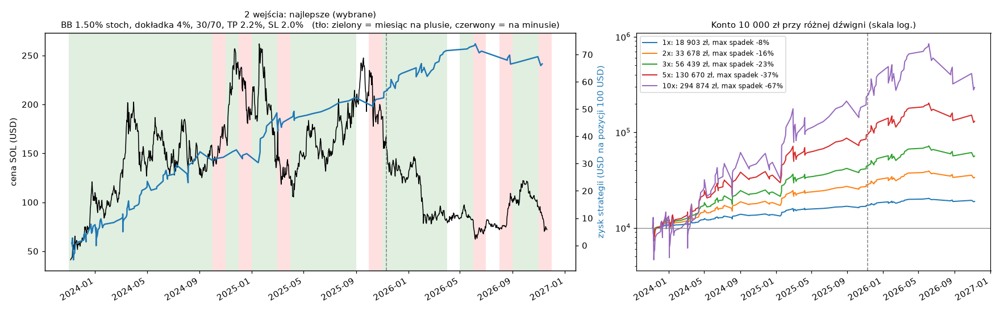

#  trading bot + backtesting engine

A live cryptocurrency trading bot (FastAPI, deployed 24/7 on Railway) and the research engine I built to answer one question: **does the strategy actually have an edge, or did it just look good?**

Short answer so far: the original strategy did **not** have an edge after fees. Testing on three years of minute data found settings that do on SOL. Validated on coins they were never tuned on, the **simplest** version holds up best: it is profitable on 3 of 4 coins. The more complex versions that looked best on SOL did not transfer.

> **Status:** active research project. The live bot runs the original rules; the research below decides what it should run next.



---

## Repository layout

```
api.py, index.html      live bot + dashboard (FastAPI, vanilla JS), deployed on Railway
historia.csv            live trade log (written by the bot through the GitHub API)
research/               backtesting engine and experiments
docs/                   charts used in this README
```

| `research/` file | What it does |
|---|---|
| `data.py` | Market data cache: OHLCV from OKX via `ccxt`, stored in SQLite, downloads only missing ranges |
| `strategy.py`, `backtest.py` | First backtester on closed 15-minute candles, random-entry benchmark, fees, ambiguous candles resolved on 1-minute data |
| `livemode.py` | Simulation of the live bot on 1-minute data: indicators recomputed on the *unclosed* candle, exactly like the bot does |
| `grid.py` | Parameter grid search (114k combinations): vectorised entry detection and an event-skipping position simulator |
| `grid_avg.py` | Grid search with position averaging: 2–3 entries, capital splits, entry spacing, TP from average price, per-year results |
| `grid_vol.py`, `tune_tpsl.py` | Volatility-adjusted parameters (TP/SL scaled by recent volatility) |
| `diagnose.py`, `bbw_filter.py` | When does the strategy lose? Drawdowns, losing streaks, market regimes, Bollinger width filter |
| `cross_coin.py` | Out-of-sample test of frozen settings on other coins |
| `report.py` | Charts: equity vs price per month, account at different leverage |
| `test_grid.py`, `test_grid_avg.py` | Unit tests of the simulators on hand-built candles (`pytest`) |

## Method

- **Data:** OKX spot, 1-minute candles, Nov 2023 – Nov 2026 (~1.6M candles per coin). 15-minute candles are built from them.
- **Train / test split:** parameters are chosen **only** on Nov 2023 – Nov 2025. Nov 2025 – Nov 2026 is used once, to check.
- **Other coins:** settings are frozen on SOL, then run unchanged on BTC, ETH and XRP. For those coins all three years are unseen data.
- **Fees:** 0.05% per side (OKX taker), position size 100 USD.
- **No look-ahead:** indicators use only closed candles (or the current price, as the live bot does). Intra-candle order of TP/SL is resolved on 1-minute data; when it is still ambiguous, the stop loss is assumed to hit first.
- **Random-entry benchmark:** every configuration is compared with random entries using the *same* TP, SL and averaging rules. With TP 1% / SL 2%, a coin flip already wins ~67% of the time, so win rate alone proves nothing.
- **Selection rule:** settings are picked by profit / max drawdown on train, preferring the centre of a stable region of good settings over the single best row.

## Findings

1. **The original strategy had no edge.** BB(20,2), 1% beyond the band, StochRSI, TP 1% / SL 3%, simulated exactly like the live bot over 3 years: win rate 76.8% vs 77.5% needed to break even after fees. The live bot looked profitable mainly because its trade log ignores fees and its polling loop missed fast wicks that a real stop order would have caught.
2. **The backtest reproduces the live bot.** 26 of 29 live trades were matched by the 1-minute simulation, 25 with the same outcome.
3. **Distance from the band is what matters.** Entries closer than ~1.2% beyond the band never beat random. From ~1.7% to 2.2%, 73–91% of *all* TP/SL combinations were profitable in both train and test on SOL.
4. **Win rate is misleading.** The median of 147k two-entry settings had a 92% win rate and lost money. The best one had 85%.
5. **Averaging: most of the capital belongs on the first entry.** Results improve steadily as more capital goes to the signal entry; "double down" splits do worst. Three entries overfit: 98% win rate on train, losses on test.
6. **Lowering the take profit after averaging hurts.** Win rate barely changes, but the large wins that pay for the losses disappear.
7. **Narrow Bollinger Bands are only a problem for close entries.** At 1% beyond the band, breakouts from narrow bands lose more often. At 1.5–1.9%, the distance itself already filters them out.
8. **Scaling TP/SL with recent volatility fixed the bad year on SOL** (2025 went from −24 to +5 USD), but did not help on every coin.
9. **The best SOL setting did not transfer; the simplest one did.** See the table below.

### Results on SOL/USDT (100 USD position, after fees)

| Strategy | Train (2y) | Test (1y) | Max drawdown | Win rate |
|---|---|---|---|---|
| Original live bot rules | −8.1 | −7.9 | −77.6 | 77% |
| 1 entry: BB 1.9%, TP 2.0%, SL 4.6% | +51.7 | +5.2 | −62.7 | 75% |
| 2 entries: BB 1.5% + StochRSI, add at 4%, 30/70, TP 2.2%, SL 2% | +56.2 | +10.3 | −8.0 | 85% |
| 3 entries: best on train | +73.1 | −8.0 | −16.7 (test) | 98% |

### Cross-asset validation (settings frozen on SOL, 3 years, USD per 100 USD position)

| Strategy | SOL | BTC | ETH | XRP | Total |
|---|---|---|---|---|---|
| **1 entry, fixed %** | +56.9 | **+39.3** | **+18.2** | −16.5 | **+97.9** |
| 1 entry, TP/SL scaled by volatility | +60.2 | +46.6 | +37.2 | −56.2 | +87.8 |
| 2 entries (best on SOL) | +66.5 | +14.8 | −21.5 | −1.6 | +58.2 |
| 3 entries | +65.1 | +13.4 | −31.2 | +26.5 | +73.8 |

The two-entry setting had the smoothest equity curve on SOL (max drawdown 8 USD over 3 years) but lost on ETH. The plain one-entry version is the only one profitable on SOL, BTC and ETH. More parameters fit SOL better and other markets worse. ADA, BNB and HYPE are being added as a further unseen test.

## Limitations

- Funding fees on perpetual futures and slippage on stop orders are not modelled.
- Roughly 40–280 trades per coin over 3 years: encouraging, not proof.
- The leverage charts show one historical path, not a distribution of outcomes.

## Running it

```bash
cd research
pip install -r requirements.txt
python cross_coin.py download   # fill the SQLite cache with 1-minute candles
python cross_coin.py            # frozen settings on every coin
pytest                          # simulator tests
```

## Roadmap

- Results on ADA, BNB, HYPE and a multi-coin portfolio equity curve
- Monte Carlo resampling of trades: distribution of drawdowns and probability of ruin per leverage
- Paper trading on an exchange testnet through the API, compared with the backtest
- `/api/backtest` endpoint and a dashboard to run backtests for any coin